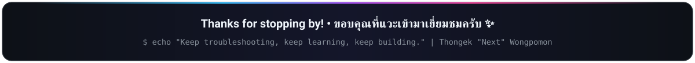

<!-- Hero Banner -->

  

<!-- Animated Typing Tagline -->

  

<!-- Quick Badges & Navigation -->

  
  
  

  <a href="#-about-me">🎯 About</a> •
  <a href="#-tech-stack--skills">🧰 Tech Stack</a> •
  <a href="#-certifications">📜 Certifications</a> •
  <a href="#-github-metrics">📊 Metrics</a> •
  <a href="#-connect-with-me">📫 Connect</a>

---

## 🎯 About Me

<table width="100%">
  <tr>
    <td width="58%" valign="top">
      

        I am a dedicated <b>IT Support Professional</b> actively transitioning into a <b>Software Developer</b> role.
        With a solid foundation in system operations, troubleshooting, and network labs, I am shifting my focus
        toward building scalable web applications and open-source solutions.
      

      <ul>
        <li>💼 <b>Current Role:</b> IT Support &amp; Developer at <i>Intermedical Care and Lab Hospital Public Company Limited</i></li>
        <li>📍 <b>Location:</b> 48/87 10/1 Pruksatown Nexts Krathum Lom, Sam Phran District, Nakhon Pathom 73220</li>
        <li>💡 <b>Interests:</b> Web Development, IoT, Network Labs, Open Source Contribution</li>
        <li>⛪ <b>Faith:</b> The Church of Jesus Christ of Latter-day Saints</li>
        <li>⚽ <b>Hobbies:</b> Supporter of <i>Bayern München</i> 🇩🇪 · Football Manager (FM), CS2 &amp; LoL</li>
      </ul>
    </td>
    <td width="42%" align="center" valign="middle">
      
    </td>
  </tr>
</table>

---

## 🧰 Tech Stack & Skills

<table width="100%">
  <tr>
    <td width="50%" align="center" valign="top">
      <h3>🎨 Frontend</h3>
      

        
      

      HTML5 · CSS3 · JavaScript · Dart
    </td>
    <td width="50%" align="center" valign="top">
      <h3>⚙️ Backend &amp; Database</h3>
      

        
      

      Node.js · Express · MongoDB · MySQL · SQLite · Firebase
    </td>
  </tr>
  <tr>
    <td width="50%" align="center" valign="top">
      <h3>🧩 Frameworks &amp; Libraries</h3>
      

        
      

      React · Next.js · Vue.js · Nuxt.js · Tailwind CSS · Flutter · Vite
    </td>
    <td width="50%" align="center" valign="top">
      <h3>🐳 DevOps &amp; Tools</h3>
      

        
      

      Docker · Git · GitHub · Postman · npm
    </td>
  </tr>
  <tr>
    <td colspan="2" align="center" valign="top">
      <h3>💻 OS, Scripting &amp; Editor</h3>
      

        
      

      Windows · Bash · PowerShell · VS Code
    </td>
  </tr>
</table>

---

## 📜 Certifications

<table width="100%">
  <tr>
    <td width="42%" align="center" valign="middle">
      
    </td>
    <td width="58%" valign="middle">
      <h3>🛡️ TH POP Firewalls Training Certificate</h3>
      

        <b>Issued by:</b> ADP JRP 
        Demonstrating hands-on skills in network architecture, perimeter defense, and firewall configuration.
      

      

        
        
        
      

    </td>
  </tr>
</table>

---

## 📊 GitHub Metrics

  

<table width="100%">
  <tr>
    <td width="62%" align="center" valign="middle">
      
    </td>
    <td width="38%" align="center" valign="middle">
      
    </td>
  </tr>
</table>

---

## 📫 Connect with Me

  
  

  

