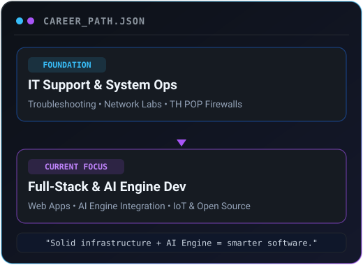
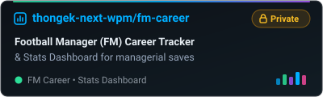
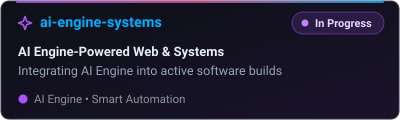

<!-- Hero Banner -->

  

<!-- Animated Typing Tagline -->

  

<!-- Quick Badges & Navigation -->

  
  
  

  <a href="#-about-me">🎯 About</a> •
  <a href="#-featured-projects">🚀 Projects</a> •
  <a href="#-tech-stack--skills">🧰 Tech Stack</a> •
  <a href="#-certifications">📜 Certifications</a> •
  <a href="#-github-metrics">📊 Metrics</a> •
  <a href="#-connect-with-me">📫 Connect</a>

---

## 🎯 About Me

<table width="100%">
  <tr>
    <td width="58%" valign="top">
      

        I am an <b>IT Support Professional</b> transitioning into a <b>Software Developer</b>, combining
        hands-on experience in system operations, troubleshooting, and network labs with modern software engineering.
        My focus is on building scalable full-stack web applications, integrating <b>AI Engine</b> into active
        workflows, and contributing to open-source solutions.
      

      <ul>
        <li>💼 <b>Current Role:</b> IT Support &amp; Developer at <i>Intermedical Care and Lab Hospital Public Company Limited</i></li>
        <li>🤖 <b>Current Focus:</b> Full-stack web applications &amp; smart workflow automation powered by <b>AI Engine</b></li>
        <li>📍 <b>Location:</b> 48/87 10/1 Pruksatown Nexts Krathum Lom, Sam Phran District, Nakhon Pathom 73220</li>
        <li>💡 <b>Interests:</b> Web Development, AI Engine, IoT, Network Labs, Open Source</li>
        <li>⛪ <b>Faith:</b> The Church of Jesus Christ of Latter-day Saints</li>
        <li>⚽ <b>Hobbies:</b> <i>Bayern München</i> supporter 🇩🇪 · Football Manager (FM), CS2 &amp; LoL</li>
      </ul>
    </td>
    <td width="42%" align="center" valign="middle">
      
    </td>
  </tr>
</table>

---

## 🚀 Featured Projects

<table width="100%">
  <tr>
    <td width="50%" valign="top">
      

        
      

      

        <b>⚽ FM Career Tracker &amp; Stats Dashboard</b> <i>(Private Repo)</i> 
        A dedicated Football Manager (FM) career tracker and statistics dashboard built to organize managerial saves, match logs, and season progress.
      

      

        
        
        
      

    </td>
    <td width="50%" valign="top">
      

        
      

      

        <b>🏋️ Workout Buddy — Supabase Edition</b> 
        Full-stack workout tracker powered by React, Express, <b>Supabase</b> (PostgreSQL, Auth, RLS), and Google OAuth with a modern athletic dashboard.
      

      

        
        
        
        
      

    </td>
  </tr>
  <tr>
    <td width="50%" valign="top">
      

        
      

      

        <b>📊 Self-Hosted GitHub Metrics API</b> 
        Customized deployment of GitHub Readme Stats on Vercel powering live profile analytics, language breakdowns, and project pin cards.
      

      

        
        
        
      

    </td>
    <td width="50%" valign="top">
      

        
      

      

        <b>🤖 AI Engine-Powered Systems &amp; Web Apps</b> <i>(In Active Development)</i> 
        Integrating <b>AI Engine</b> capabilities into ongoing web and workflow automation projects to deliver smarter data processing and system assistance.
      

      

        
        
        
      

    </td>
  </tr>
</table>

  

---

## 🧰 Tech Stack & Skills

<table width="100%">
  <tr>
    <td width="50%" align="center" valign="top">
      <h3>🎨 Frontend</h3>
      

        
      

      HTML5 · CSS3 · JavaScript · Dart
    </td>
    <td width="50%" align="center" valign="top">
      <h3>⚙️ Backend &amp; Database</h3>
      

        
      

      Node.js · Express · Supabase · PostgreSQL · MongoDB · MySQL · SQLite · Firebase
    </td>
  </tr>
  <tr>
    <td width="50%" align="center" valign="top">
      <h3>🧩 Frameworks &amp; Libraries</h3>
      

        
      

      React · Next.js · Vue.js · Nuxt.js · Tailwind CSS · Flutter · Vite
    </td>
    <td width="50%" align="center" valign="top">
      <h3>🐳 DevOps &amp; Tools</h3>
      

        
      

      Docker · Git · GitHub · Postman · npm
    </td>
  </tr>
  <tr>
    <td width="50%" align="center" valign="top">
      <h3>💻 OS, Scripting &amp; Editor</h3>
      

        
      

      Windows · Bash · PowerShell · VS Code
    </td>
    <td width="50%" align="center" valign="top">
      <h3>🤖 AI Tools, Engine &amp; Automation</h3>
      

        
         
        
        
        
      

      Google Gemini · Antigravity · Claude · Claude Code · AI Engine &amp; Automation
    </td>
  </tr>
</table>

---

## 📜 Certifications

<table width="100%">
  <tr>
    <td width="42%" align="center" valign="middle">
      
    </td>
    <td width="58%" valign="middle">
      <h3>🛡️ TH POP Firewalls Training Certificate</h3>
      

        <b>Issued by:</b> ADP JRP 
        Demonstrating hands-on skills in network architecture, perimeter defense, and firewall configuration.
      

      

        
        
        
      

    </td>
  </tr>
</table>

---

## 📊 GitHub Metrics

  

<table width="100%">
  <tr>
    <td width="62%" align="center" valign="middle">
      
    </td>
    <td width="38%" align="center" valign="middle">
      
    </td>
  </tr>
</table>

---

## 📫 Connect with Me

  
  

  

